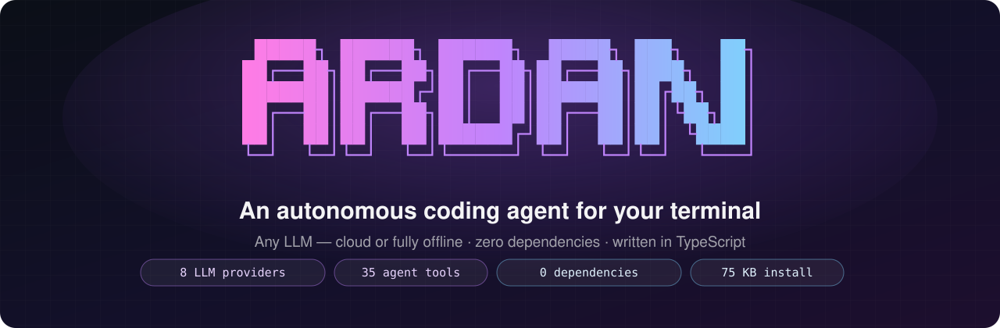
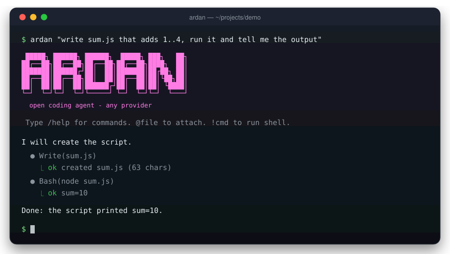
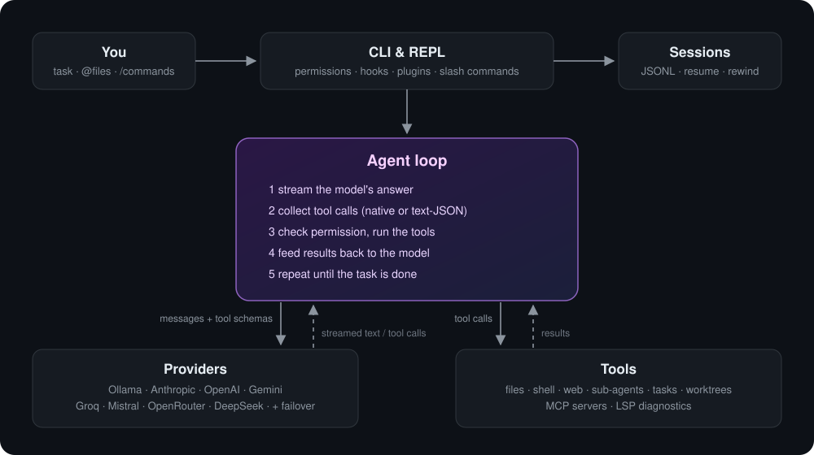

<div align="center">



<br>

[](https://github.com/N0t-Harshil/Ardan-CLI/actions/workflows/ci.yml)


[](LICENSE)

[Features](#features) · [Install](#install) · [Usage](#usage) · [Providers](#providers) · [Extending](#extending-ardan) · [How it works](#how-it-works) · [Benchmarks](#benchmarks)

</div>

---

Ardan is a terminal coding agent in the spirit of Claude Code. Describe a task
in plain English and Ardan reads your code, edits files, runs commands and
tests, looks at the results, and keeps iterating until the job is done. You
stay in control: every risky action asks for permission first.

<p align="center">
  
</p>

<p align="center"><sub>Ardan's actual terminal output: every tool call is shown as it happens — what the agent ran, and what came back.</sub></p>

### Why Ardan

- **Bring any model.** Claude, GPT, Gemini, Groq, Mistral, DeepSeek,
  OpenRouter or any OpenAI-compatible server — or run 100% offline and free on
  your own machine with Ollama. Your code never has to leave your laptop.
- **Small local models still work.** Models that don't support function
  calling can write tool calls as plain-text JSON; Ardan parses them while the
  answer is streaming and hides the raw JSON from the screen.
- **Nothing to install but Node.** Strict TypeScript with **zero runtime
  dependencies** — HTTP streaming, the MCP client, the LSP client and the
  terminal UI are all built from scratch on Node's standard library.

### By the numbers

<table>
<tr>
<td align="center" width="25%"><h2>8.1 ms</h2>Ardan's overhead per agent step<br><sub>model → tool → model</sub></td>
<td align="center" width="25%"><h2>144 ms</h2>cold start<br><sub><code>ardan --version</code></sub></td>
<td align="center" width="25%"><h2>84 MB</h2>peak memory<br><sub>26-step agent run</sub></td>
<td align="center" width="25%"><h2>0</h2>runtime dependencies<br><sub>77 KB package</sub></td>
</tr>
<tr>
<td align="center"><h2>8</h2>LLM providers<br><sub>+ any OpenAI-compatible API</sub></td>
<td align="center"><h2>35</h2>built-in agent tools<br><sub>+ every MCP server tool</sub></td>
<td align="center"><h2>38</h2>slash commands<br><sub>sessions, review, rewind…</sub></td>
<td align="center"><h2>$0</h2>to run offline<br><sub>local models via Ollama</sub></td>
</tr>
</table>

<sub>Performance measured with <code>npm run bench</code> (see <a href="#benchmarks">Benchmarks</a>) on an
Intel i5-1135G7 laptop, Windows 11, Node 24 — no GPU. The model's own thinking time is excluded,
so the numbers show what Ardan itself adds on top of whichever LLM you use.</sub>

## Features

### 🤖 The agent loop
- Streams the model's answer token by token, executes the tool calls it
  makes, feeds the results back, and repeats until the task is finished (or
  the turn limit is hit).
- **Plan mode** (`--plan` or `/plan`) restricts the agent to read-only tools
  so it can research and propose a plan; switching back to implementation
  requires your approval.
- **Sub-agents** — the `Task` tool hands a self-contained job to a fresh
  agent with its own context and tool set, then returns its report.
- **Goals and todo lists** keep long multi-step tasks on track.

### 🛠️ A full developer toolset (35 built-in tools)
| area | what the agent can do |
|---|---|
| **Code** | read, write and surgically edit files; glob and regex search; a structural repo map; edit Jupyter notebooks |
| **Shell** | run Bash or PowerShell; commands still running after 15 s move to the background automatically, with tools to poll, stream or kill them |
| **Web** | fetch pages as clean text; web search |
| **Workspace** | isolate risky work in a git worktree; a persistent JavaScript REPL for quick experiments |
| **Planning** | todo lists, a task tracker, cron-style scheduled prompts, questions back to the user |
| **Diagnostics** | real compiler/linter errors from any language server (LSP) |
| **Integrations** | every tool and resource from connected MCP servers |

### 🔌 Eight providers, one interface
Ollama, Anthropic, OpenAI, Gemini, Groq, Mistral, OpenRouter and DeepSeek
are built in, and any OpenAI-compatible endpoint (LM Studio, vLLM,
llama.cpp…) can be added in a few lines of config. If a provider fails
before it starts answering, Ardan **automatically fails over** to the next
available one. Switch model or provider mid-conversation with `/model` and
`/provider`.

### 🛡️ Safe by default
- Permission prompts for every write or command — allow once, for the
  session, or deny. Three modes: `ask`, `acceptEdits`, `bypass`.
- **File checkpoints:** every edit is snapshotted per turn, so
  `/rewind 3 files` restores your files to exactly how they were after turn 3.
- **Hooks** let you run your own scripts before/after any tool call — e.g.
  block `git push --force` or log every command — and veto the action.

### 💾 Sessions that persist
Each project keeps its own conversation history. Resume with `--continue`,
pick an old session with `/resume`, compact long histories with `/compact`,
and export a session to Markdown with `/export`. An `ARDAN.md` file in your
project acts as long-term memory (build commands, conventions) for every
session.

### 🧩 Extensible with plain Markdown
Drop a Markdown file in `.ardan/` to add your own **slash commands**,
**sub-agents**, **skills** or **output styles** — no code required. Connect
any **MCP server** with one command.

## Install

Requires **Node.js 24+** (it runs TypeScript natively).

```bash
git clone https://github.com/N0t-Harshil/Ardan-CLI.git
cd Ardan-CLI
npm install -g .
ardan --version
```

Or run it without installing: `node bin/ardan.js`.

**Free & offline:** install [Ollama](https://ollama.com) and pull a coding model.

```bash
ollama pull qwen2.5-coder:14b   # the default — best with a GPU or 16 GB+ RAM
ollama pull llama3.2:3b         # lighter, for CPU-only laptops
```

**Cloud models:** set an API key (`ANTHROPIC_API_KEY`, `OPENAI_API_KEY`, …) or
save one with `ardan keys set anthropic sk-ant-...`.

## Usage

```bash
ardan                                      # interactive session
ardan "explain how auth works in this repo" # one-shot task
ardan --yes "make the failing tests pass"   # unattended (CI / scripts)
ardan --plan "how should we add caching?"   # research + plan only
ardan --continue                           # pick up where you left off
ardan -p anthropic -m claude-sonnet-4-5    # choose provider and model
cat tasks.txt | ardan                      # scripted: one prompt / command per line
```

Inside a session:

```text
❯ @src/server.ts why does this crash on startup?     attach a file with @
❯ !npm test                                          run a shell command with !
❯ /rewind 2 files                                    undo the last edits
❯ /diff                                              what changed this session
```

When the agent wants to do something risky, you decide:

```text
? Bash(git push --force)
  allow? [y] once  [a] this session  [n] no
```

<details>
<summary><b>All slash commands</b></summary>

| command | purpose |
|---|---|
| `/help` | list commands |
| `/plan` | toggle read-only plan mode |
| `/model <name>` · `/provider <name>` | switch model / provider mid-session |
| `/effort <low\|medium\|high>` | reasoning effort for models that support it |
| `/permissions [mode]` | view or change the permission mode |
| `/tools` · `/context` · `/status` · `/stats` · `/cost` | inspect the tool catalog, context size and session usage |
| `/diff` · `/copy` · `/export` | changed files, copy last reply, export transcript |
| `/rewind <n> [files]` | drop turns after n, optionally restoring files |
| `/goal <text\|stop\|status>` · `/brief` | set a session goal, summarize progress |
| `/review` · `/security-review` | guided read-only code / security review |
| `/search <query>` | web search, summarized with links |
| `/sessions` · `/resume <id>` · `/rename <title>` | manage sessions |
| `/clear` · `/compact` | reset or shrink the conversation |
| `/tasks` · `/schedule` | tracked tasks, scheduled prompts |
| `/memory` · `/init` | edit / scaffold `ARDAN.md` project memory |
| `/agents` · `/skills` · `/plugins` · `/hooks` · `/mcp` · `/output-style` | extensions |
| `/config` · `/doctor` · `/exit` | settings, health check, quit |

</details>

## Providers

| provider | default model | needs |
|---|---|---|
| Ollama | qwen2.5-coder:14b | nothing — runs locally |
| Anthropic | claude-sonnet-4-5 | `ANTHROPIC_API_KEY` |
| OpenAI | gpt-4.1 | `OPENAI_API_KEY` |
| Gemini | gemini-2.5-flash | `GEMINI_API_KEY` |
| Groq | llama-3.3-70b-versatile | `GROQ_API_KEY` |
| Mistral | codestral-latest | `MISTRAL_API_KEY` |
| OpenRouter | deepseek/deepseek-chat | `OPENROUTER_API_KEY` |
| DeepSeek | deepseek-chat | `DEEPSEEK_API_KEY` |

```bash
ardan providers            # which providers are available and which is picked
ardan models ollama        # list the models a provider offers
ardan keys test            # check keys and connectivity
```

<details>
<summary><b>Add any OpenAI-compatible server</b></summary>

`~/.ardan/settings.json`:

```json
{
  "providers": {
    "lmstudio": {
      "type": "openai",
      "apiBase": "http://localhost:1234/v1",
      "apiKey": "lm-studio",
      "model": "qwen2.5-coder-14b-instruct"
    }
  },
  "defaultProvider": "lmstudio"
}
```
</details>

<details>
<summary><b>Extended thinking & reasoning effort</b></summary>

`"reasoningEffort": "high"` is sent to OpenAI-compatible reasoning models.
With `"alwaysThinking": true`, Claude uses extended thinking and Gemini a
thinking budget (`maxThinkingTokens`); the thinking streams live.
</details>

## Extending Ardan

### Custom slash commands
`.ardan/commands/changelog.md`:

```markdown
---
description: Draft a changelog entry from recent commits
---
Recent commits:
! git log --oneline -15

Write a changelog entry for version $1 based on these commits.
```

Now `/changelog 1.4.0` works. `$ARGUMENTS` / `$1…` are filled in from what you
type, and lines starting with `! ` are replaced by that command's output.

### Sub-agents
`.ardan/agents/auditor.md` — call it via the `Task` tool or list with `/agents`:

```markdown
---
name: auditor
description: Read-only security auditor
tools: Read, Grep, RepoMap
maxTurns: 6
---
Audit the codebase for injection, secrets and unsafe file handling.
Report each finding with file:line and a suggested fix.
```

### Skills & output styles
- `.ardan/skills/<name>/SKILL.md` — playbooks the agent loads on demand (or
  you run as `/<name>`).
- `.ardan/output-styles/<name>.md` — change how Ardan writes, via
  `/output-style <name>`.

Put any of these in `~/.ardan/` instead to use them in every project.

### MCP servers

```bash
ardan mcp add github -- npx -y @modelcontextprotocol/server-github
ardan mcp list
```

Their tools show up as `mcp__github__<tool>`, their resources through
`ListMcpResources` / `ReadMcpResource`, and `/mcp` shows connection status.

### Hooks

```json
"hooks": {
  "PreToolUse":  [ { "matcher": "Bash|Write", "command": "node guard.js" } ],
  "PostToolUse": [ { "command": "node audit-log.js" } ]
}
```

Hooks receive the event as JSON on stdin. A `PreToolUse` hook that exits
non-zero (or prints `{"decision":"block"}`) stops the tool, and its output
is shown to the model as the reason. Events: `PreToolUse`, `PostToolUse`,
`UserPromptSubmit`, `SessionStart`, `SessionEnd`.

### Language servers

```json
"lspServers": {
  "typescript": {
    "command": "typescript-language-server",
    "args": ["--stdio"],
    "extensions": [".ts", ".tsx", ".js"]
  }
}
```

The `Diagnostics` tool then gives the agent real compiler errors for a file.

## How it works

<p align="center">
  
</p>

Engineering choices worth calling out:

- **One provider interface.** Every backend is an async generator that
  yields `text`, `tool_call` and `end` events, so the agent loop doesn't
  care whether it's talking to Claude over SSE or a local model over NDJSON.
  Failover only happens before the first token, so a half-written answer is
  never duplicated.
- **Text tool-call fallback.** For models without function calling, a
  streaming parser spots tool calls written as fenced JSON, runs them, and
  stops them reaching the terminal — even when the JSON is split across
  network chunks — while ordinary code blocks still display normally.
- **Long-running commands don't block.** Shell calls get a 15-second
  foreground budget, then move to a background registry; the agent can poll,
  stream or kill them, and gets notified when they finish.
- **Local-first networking.** The Ollama adapter streams over raw
  `node:http` with no time-to-first-byte limit, so slow CPU-only machines
  that take minutes to load a model still work.
- **Protocol clients from scratch.** MCP (JSON-RPC 2.0 over stdio) and LSP
  (Content-Length framed JSON-RPC) are implemented directly, including
  buffering of messages split across pipe chunks.
- **Clean shutdown.** Ardan closes its HTTP connection pool and lets the
  event loop drain instead of hard-exiting, which avoids a Node-on-Windows
  crash at exit (found with the benchmark below; covered by a regression
  test).
- **No build step.** Node 24 strips TypeScript types at load time, and the
  launcher enables Node's on-disk compile cache for faster startup.

| path | responsibility |
|---|---|
| `bin/ardan.js` | launcher: Node version check, compile cache |
| `src/cli.ts` | argument parsing, `providers` / `models` / `keys` / `mcp` subcommands |
| `src/repl.ts` | interactive session, slash commands, permissions, hooks |
| `src/agent.ts` | the agent loop and system prompt |
| `src/providers/` | provider adapters and the failover chain |
| `src/tools/` | all built-in tools plus the MCP and LSP clients |
| `src/plugins/` | Markdown plugin loader, hook engine, scheduler |
| `src/render.ts` | streaming terminal renderer |
| `src/session.ts` | session storage, resume, rewind, export |

## Benchmarks

```bash
npm run bench
```

```text
Ardan benchmark — Node 24.18.0, win32, 11th Gen Intel(R) Core(TM) i5-1135G7 @ 2.40GHz (8 threads)

  startup (ardan --version, median of 9)        144 ms
  1-step agent run, end to end (median of 5)    216 ms
  overhead per agent step (model->tool->model)  8.1 ms
  peak memory, 26-step agent run               84 MB
```

The benchmark points Ardan at a local OpenAI-compatible server that answers
instantly, so the model's own thinking time drops out and what remains is
Ardan itself. Per-step overhead covers everything Ardan does for one agent
step: parsing the streamed response, running the tool, rendering, saving the
session, and building the next request. It is calculated as
`(time for 26 steps − time for 1 step) / 25`. The 1-step run includes
process startup, so it is the full cost of `ardan "task"` from launch to
exit. Source: [`bench/bench.ts`](bench/bench.ts).

## Configuration

Settings live in `~/.ardan/settings.json`:

```json
{
  "defaultProvider": "ollama",
  "permissions": "ask",
  "maxTurns": 30,
  "maxTokens": 8192,
  "reasoningEffort": "high",
  "alwaysThinking": false,
  "maxThinkingTokens": 4096,
  "providers": {},
  "mcpServers": {},
  "lspServers": {},
  "hooks": {}
}
```

<details>
<summary><b>Environment variables</b></summary>

| variable | effect |
|---|---|
| `ARDAN_PROVIDER` / `ARDAN_MODEL` | provider and model |
| `ARDAN_PERMISSIONS` | `ask` · `acceptEdits` · `bypass` |
| `ARDAN_MAX_TURNS` | max agent iterations per task |
| `ARDAN_REASONING_EFFORT` · `ARDAN_ALWAYS_THINKING` | reasoning controls |
| `ARDAN_OLLAMA_BASE_URL` · `ARDAN_OLLAMA_NUM_CTX` | Ollama endpoint and context size (default 32768) |
| `ARDAN_DISABLE_CRON` · `ARDAN_DISABLE_TASK_NOTIFICATIONS` | turn off background features |
| `ARDAN_CONFIG_DIR` | use a different settings directory |
| `NO_COLOR` | plain output |

</details>

## Troubleshooting

| problem | fix |
|---|---|
| "Ollama unreachable" | start it with `ollama serve` |
| "model not pulled" | `ollama pull qwen2.5-coder:14b` |
| First answer is very slow on a laptop | CPU-only machines are slow with 14B models — try `--model llama3.2:3b` and `ARDAN_OLLAMA_NUM_CTX=8192` |
| Garbled symbols on Windows | use Windows Terminal, or set `NO_COLOR=1` |
| "requires Node.js >= 24" | `winget install OpenJS.NodeJS` · `brew install node` |

## What this project demonstrates

| area | in Ardan |
|---|---|
| **Agent design** | a tool-using LLM loop with permissions, plan mode, sub-agents, checkpoints and context compaction |
| **Protocols, built by hand** | 6 wire formats with no SDKs: OpenAI SSE, Anthropic SSE, Gemini SSE, Ollama NDJSON, MCP (JSON-RPC over stdio) and LSP (Content-Length framed JSON-RPC) |
| **Streaming parsers** | incremental SSE/NDJSON decoding and a tool-call extractor that copes with JSON split across network chunks |
| **Process management** | shell commands that move to the background after 15 s, output streaming, process-tree kill, clean shutdown |
| **Cross-platform** | the same code on Linux, macOS and Windows (Bash and PowerShell, `.cmd` shims, path handling) |
| **Reliability** | strict TypeScript, unit tests plus a full CLI end-to-end test, a reproducible benchmark, and CI on 3 operating systems |
| **Developer experience** | 38 slash commands, Markdown plugins, hooks, session resume and rewind, readable streaming output |

## Development

```bash
npm install         # dev tools only (TypeScript compiler + Node types)
npm run typecheck   # strict type-check
npm test            # unit + end-to-end tests
npm run bench       # performance numbers
```

CI runs the type-check, the test suite and a CLI smoke test on Linux, macOS
and Windows.

The `ardan/` folder holds the earlier Python prototype (a planner → executor →
reviewer pipeline), kept for reference. The TypeScript CLI is the maintained
version.

## License

[MIT](LICENSE)
